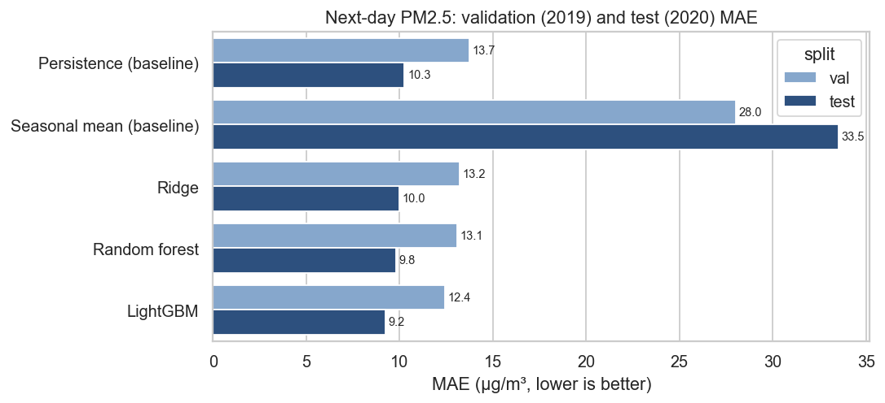
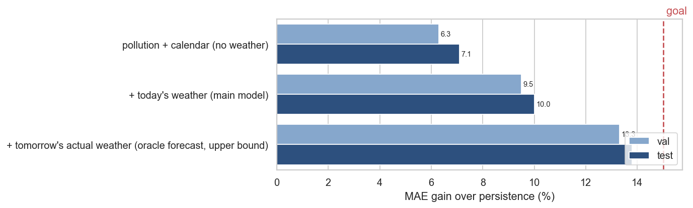
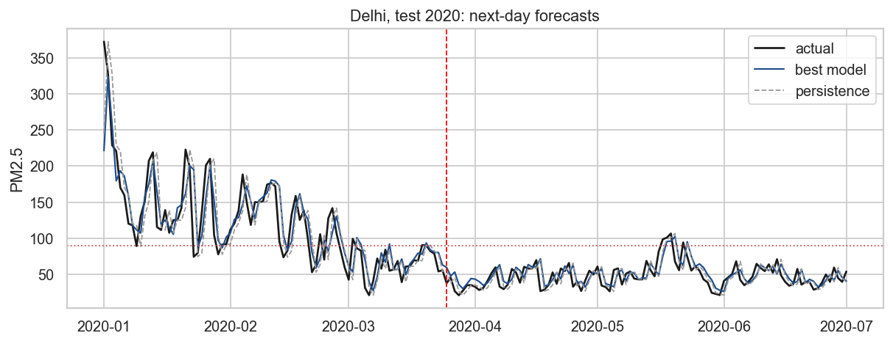

# Data Science Project + Learning Game

Two deliverables in one repository:

| Part | What | Folder | Marks |
|---|---|---|---|
| **A** | **Next-day PM2.5 forecasting for 26 Indian cities**: a full data-science pipeline, from raw data to report | [`partA-project/`](partA-project/) | 10 |
| **B** | **"Overfit or Not?"**: a game where you *discover* overfitting and the bias–variance trade-off by playing | [`partB-game/`](partB-game/) | 5 |

---

## 1. Quick start

**Requirements:** Python **3.12**, about 2 GB free RAM, and an internet connection for the first data download. Commands below are for Windows PowerShell/Git Bash; they are the same on macOS/Linux.

```bash
git clone <this repo> ds-project
cd ds-project

# (recommended) one virtual environment for both parts
python -m venv .venv
.venv\Scripts\activate            # macOS/Linux: source .venv/bin/activate

pip install -r partA-project/requirements.txt
pip install -r partB-game/requirements.txt
```

### Part A: run the whole analysis (about 12 minutes)
```bash
cd partA-project
python -m src.run_all          # download → clean → weather → features → train → evaluate → run all 3 notebooks
python -m pytest -q            # 11 tests (cleaning rules, no data leakage, time split)
python -m src.build_report     # optional: rebuild reports/report.pdf from reports/report.md
```

**Data access:** the air-quality data comes from Kaggle. Put your API token at `~/.kaggle/kaggle.json` (Kaggle → Settings → *Create New Token*). Without a token the script prints the 3 manual steps: download `city_day.csv` and drop it into `partA-project/data/raw/`. Weather comes from NASA POWER and needs no key.

### Part B: play the game
```bash
cd partB-game
streamlit run app/main.py      # opens http://localhost:8501
python -m pytest -q            # 8 tests, including a headless play-through of both levels
```
The game ships with its own small dataset, so it does not need Part A to be run first.

---

## 2. Part A: Next-day PM2.5 forecasting

**Question.** Can we forecast tomorrow's PM2.5 for a city, and flag *"Poor or worse"* days (PM2.5 > 90 µg/m³, the CPCB AQI breakpoint) 24 hours ahead, better than simply assuming *tomorrow = today*?

**Data.**
- [CPCB city-day air quality 2015–2020](https://www.kaggle.com/datasets/rohanrao/air-quality-data-in-india): 29,531 city-days, 26 cities, 12 pollutants.
- [NASA POWER](https://power.larc.nasa.gov/) daily weather per city: rain, wind, temperature, humidity and pressure.

**Method in one paragraph.**
- **Cleaning:** each rule has a stated reason (impossible values, off-season sensor spikes, sparse columns, past-only gap filling).
- **Features:** 34 leak-free features, i.e. PM2.5 history, other pollutants, today's weather, and the calendar and Diwali flag of the target day.
- **Split by time:** train 2015–18, validate 2019, test 2020; never shuffled.
- **Tuning:** 5-fold expanding-window CV inside the training years.
- **Models:** two baselines (persistence, seasonal mean) and three models (Ridge, random forest, LightGBM). The ML models predict the *change* from today.

### Results on the untouched 2020 test year

| Model | Test MAE (µg/m³) | Test RMSE | Gain vs persistence |
|---|---|---|---|
| Persistence ("tomorrow = today") | 10.26 | 17.37 | baseline |
| Seasonal mean | 33.52 | 42.21 | −227% |
| Ridge | 9.99 | 15.95 | +2.6% |
| Random forest | 9.80 | 15.67 | +4.5% |
| **LightGBM** | **9.23** | **14.99** | **+10.0%** (95% CI 8.2–11.7%) |

| Poor+ day warning (test 2020) | Precision | Recall | F1 | PR-AUC |
|---|---|---|---|---|
| Persistence rule (today > 90) | 0.71 | 0.74 | 0.72 | 0.78 |
| **LightGBM regressor + threshold** (chosen on 2019) | **0.74** | **0.75** | **0.75** | **0.83** |

| Goal (set before modelling) | Target | Achieved | Met? |
|---|---|---|---|
| G1: beat persistence on MAE | ≥ 15% | 10.0% | ✗ |
| G2: catch Poor+ days | recall ≥ 0.80, precision ≥ 0.60 | recall 0.75, precision 0.74 | ✗ (narrowly) |

**What the results mean.**
- The improvement is **real and consistent**: the same model ranking holds in CV, 2019 and 2020. LightGBM beats persistence in 25 of 26 cities and keeps its edge through the COVID-lockdown shift (before lockdown: MAE 12.4 vs 14.0; after: 6.6 vs 7.2).
- **Why G1 is missed:** an ablation shows pollution history gives +7%, today's weather +10%, and even *perfect knowledge of tomorrow's weather* only +13.8%. The remaining error comes from sudden local events (fires, mining, festival burning) that daily city averages can't see.
- **Why G2 is missed:** the threshold was tuned on 2019 (16.9% Poor+ days) and 2020 has only 8.6%. The model's PR curve still reaches recall 0.80 at precision 0.72.
- **Where it fails:** the most polluted cities (Talcher, Delhi, Guwahati), January turning points (14 of the 20 worst forecasts), and big days, which are under-predicted by about 10 µg/m³ on average.

<p align="center"> </p>
<p align="center"></p>

### Where to find things
| Want to see… | Open |
|---|---|
| The full write-up (9 pages) | [`partA-project/reports/report.pdf`](partA-project/reports/report.pdf) |
| Data cleaning and EDA with written insights | [`notebooks/01_eda.ipynb`](partA-project/notebooks/01_eda.ipynb) |
| Split, CV folds, baselines, tuning, saved-model check, **live forecast demo** | [`notebooks/02_modelling.ipynb`](partA-project/notebooks/02_modelling.ipynb) |
| All results and error analysis with commentary | [`notebooks/03_evaluation.ipynb`](partA-project/notebooks/03_evaluation.ipynb) |
| Every number as CSV/JSON | [`reports/tables/`](partA-project/reports/tables/) (`summary.json` has the goal check) |
| Code | [`src/`](partA-project/src/), one module per step; see [Part A README](partA-project/README.md) |

---

## 3. Part B: "Overfit or Not?" learning game

You're a junior data scientist. While you play, you only see how well your model fits its **training** data. **Submit** reveals its error on **hidden** data. The concept comes out of the gap between those two numbers; the game never explains it upfront.

| Level | Concept | You control | You discover |
|---|---|---|---|
| 1 · The Perfect Fit? | **Overfitting** | Polynomial degree 1–15 on 30 real patients (scikit-learn diabetes data). The slider starts on a tempting degree 10. | Training error keeps falling as the degree rises, but the hidden test error explodes. The best model is a simple one. |
| 2 · Too Simple, Too Wild | **Bias–variance trade-off** | Decision-tree depth 1–12 on real Delhi PM2.5 (day of year → pollution). *Draw another sample*, *Show all 20 analysts*. | Shallow trees all agree but are wrong (bias). Deep trees change with every sample (variance). Test error = bias² + variance + noise is lowest in between (depth 2–4). |

**Rules.**
- You get 3 submissions per level.
- Stars are given against the best score achievable on that level, computed live.
- 1 star unlocks the next level.
- Each level ends with the full error curves and a one-sentence reflection.

**Real computation.** Every score, star and hint is computed from actual model fits (seed 42); nothing is hard-coded. Every choice and reflection is logged to `playtest/logs/` as evidence of learning.

How to play, learning objectives and design rationale: [Part B README](partB-game/README.md) and [`levels/DESIGN.md`](partB-game/levels/DESIGN.md).

### Playtest (evidence of learning)
The kit is ready in [`partB-game/playtest/`](partB-game/playtest/):
1. Follow [`PROTOCOL.md`](partB-game/playtest/PROTOCOL.md): pre-quiz → 10–15 min of play → post-quiz → feedback form.
2. Record each player's scores in `quiz_results.csv`.
3. Run `python playtest/analyze.py`. It writes `summary.md` with the pre/post gain, choices from the logs and reflections.
4. Copy the results into [`REPORT.md`](partB-game/playtest/REPORT.md).

> **Status:** 1 peer session has been logged so far. The pre/post quiz and feedback results must still be collected from at least 5 peers before submission.

---

## 4. Repository layout
```
ds-project/
├── README.md                ← you are here
├── PLAN.md                  ← original plan and rubric checklist
├── partA-project/
│   ├── src/                 ← config, download_data, clean, weather, features, train, evaluate, run_all, build_report
│   ├── notebooks/           ← 01_eda, 02_modelling, 03_evaluation (executed)
│   ├── reports/             ← report.pdf/.md, figures/, tables/, cleaning_report.json
│   ├── tests/               ← test_clean.py, test_features.py
│   ├── data/                ← raw/ and processed/ (generated, not committed)
│   └── requirements.txt
└── partB-game/
    ├── app/                 ← Streamlit app (main.py) and logger
    ├── levels/              ← level1_overfitting.py, level2_bias_variance.py, DESIGN.md
    ├── data/                ← delhi_pm25.csv (+ make_data.py)
    ├── playtest/            ← protocol, quizzes, logs, analyze.py, REPORT.md
    ├── tests/               ← concept tests + headless UI test
    └── requirements.txt
```

## 5. Reproducibility
- **Seeds:** seed 42 everywhere (`partA-project/src/config.py`, game `SEED`).
- **Pinned versions:** library versions are pinned in both `requirements.txt` files.
- **Fresh-clone check:** the full pipeline was run from a fresh clone. Every figure, table and notebook output is regenerated by `python -m src.run_all`.
- **Downloads:** both datasets are downloaded and validated by scripts; the weather is cached after the first run.

## 6. Troubleshooting
| Problem | Fix |
|---|---|
| `Could not download automatically` | Add `~/.kaggle/kaggle.json`, or download `city_day.csv` by hand into `partA-project/data/raw/`. |
| Weather download retries or fails | NASA POWER is occasionally slow; re-run `python -m src.weather`. Cities already downloaded are cached. |
| Notebooks fail with `ModuleNotFoundError` in Jupyter | Open Jupyter from the same environment you installed into. `run_all` always executes the notebooks with the current interpreter. |
| `streamlit` not found | Use `python -m streamlit run app/main.py`. |
| Port 8501 busy | `streamlit run app/main.py --server.port 8502` |
| Training is slow | It uses all-but-one CPU core and takes about 8 minutes. `python -m src.run_all --no-eda` skips re-running the notebooks. |
