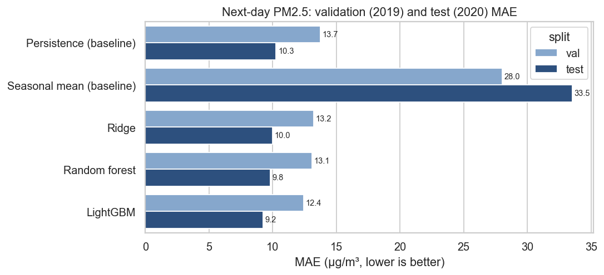
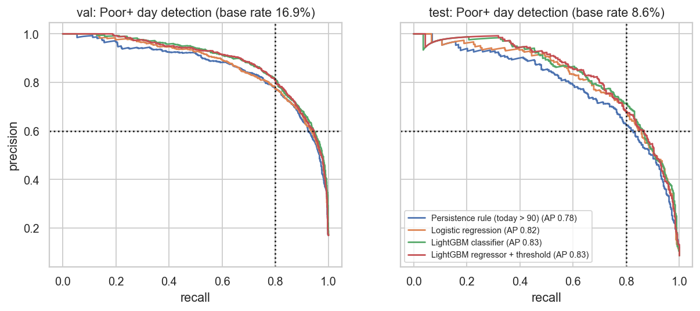
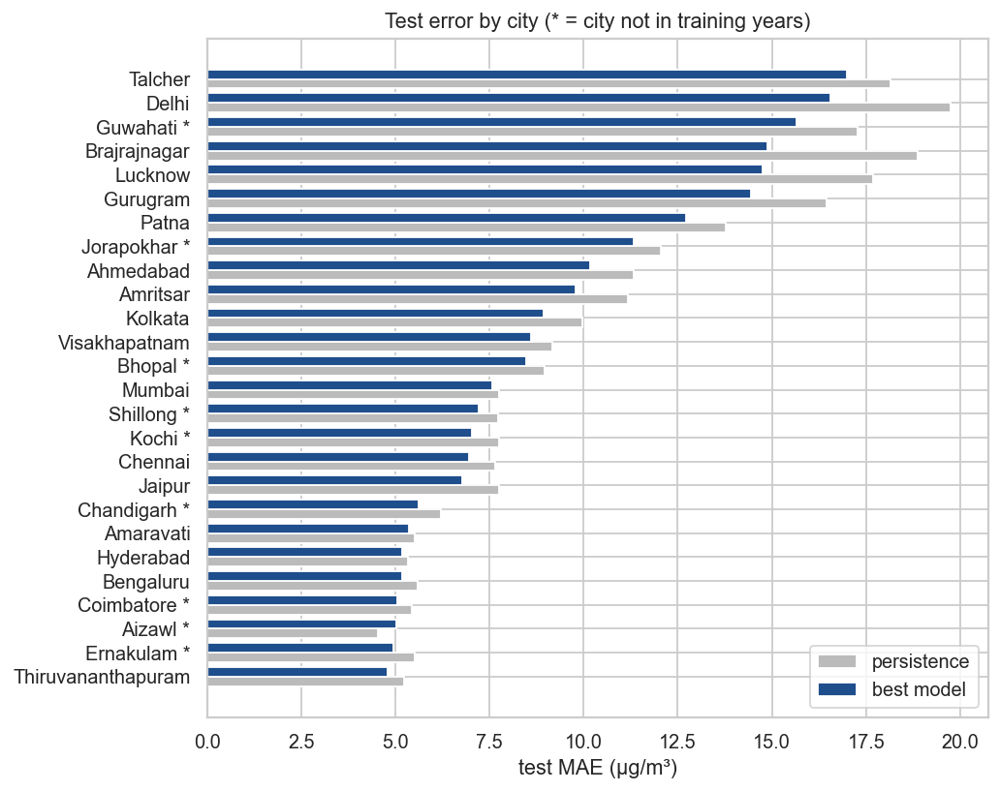
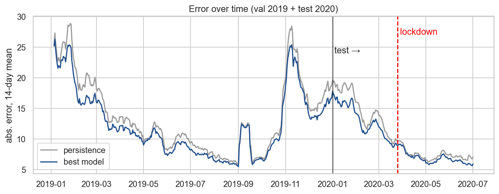

# Next-day PM2.5 forecasting for Indian cities

**Question:** can we forecast tomorrow's PM2.5 for a city, and flag "Poor or worse" days (PM2.5 > 90 µg/m³) 24 hours ahead, better than "tomorrow = today"?

**Report:** [reports/report.pdf](reports/report.pdf) (source: `reports/report.md`)

**Notebooks:**
- [01_eda](notebooks/01_eda.ipynb): cleaning decisions and plots, each with a written insight.
- [02_modelling](notebooks/02_modelling.ipynb): target check, time split, CV folds, baselines, the change target, tuning results, a re-check of the saved model, and a one-city forecast demo.
- [03_evaluation](notebooks/03_evaluation.ipynb): metrics, model comparison, ablation, classification, error analysis by time, season, city and lockdown, the 20 worst forecasts, and the goal check.

## Results (test year 2020, untouched until the end)
| | Goal | Result |
|---|---|---|
| G1 | ≥15% lower MAE than persistence | **10.0%** lower (LightGBM, MAE 9.23 vs 10.26; 95% CI 8.2–11.7%). Not met. Even with perfect knowledge of tomorrow's weather the gain is only 13.8%. |
| G2 | Poor+ recall ≥ 0.80 with precision ≥ 0.60 | recall **0.75**, precision **0.74**. Narrowly missed, because the threshold was tuned on 2019 and 2020 had half the Poor+ rate. |

The ranking (LightGBM > random forest > Ridge > persistence ≫ seasonal mean) is the same in CV, validation and test. Error analysis, bias and limitations are in the report.

## Data
- CPCB city-day air quality, 2015–2020: Kaggle [`rohanrao/air-quality-data-in-india`](https://www.kaggle.com/datasets/rohanrao/air-quality-data-in-india) (`city_day.csv`, 29,531 rows, 26 cities). Downloading it needs a Kaggle API token in `~/.kaggle/kaggle.json`; without one, the script prints manual steps.
- Daily weather per city: [NASA POWER](https://power.larc.nasa.gov/) API (free, no key). It is cached in `data/raw/weather/`.

## Run

```bash
pip install -r requirements.txt     # Python 3.12, pinned versions
python -m src.run_all               # everything, ~12 min
python -m pytest -q                 # 11 tests
python -m src.build_report          # report.md → report.html + report.pdf (uses headless Chrome/Edge)
```

`run_all` runs these steps in order. Each step can also be run on its own (all commands are run from `partA-project/`):

| # | Command | What it does | Output | Time |
|---|---|---|---|---|
| 1 | `python -m src.download_data` | Downloads `city_day.csv` via the Kaggle API and validates its columns and row count | `data/raw/city_day.csv` | < 1 min |
| 2 | `python -m src.clean` | Applies the cleaning rules and records every change | `data/processed/city_day_clean.csv`, `reports/cleaning_report.json` | seconds |
| 3 | `python -m src.weather` | Downloads daily weather for 26 cities (cached) | `data/processed/weather_daily.csv` | ~1 min the first time |
| 4 | `python -m src.features` | Builds 34 features plus the next-day target and assigns the split | `data/processed/features.csv` | seconds |
| 5 | `python -m src.train` | Time-series CV tuning → validate 2019 → refit → test 2020, plus classifiers and the ablation | `models/*.joblib`, `reports/tables/predictions.csv`, `cv_results.csv`, … | ~8 min |
| 6 | `python -m src.evaluate` | Comparison tables, bootstrap CIs, goal check, error analysis, figures | `reports/tables/*.csv`, `summary.json`, `reports/figures/*.png` | ~1 min |
| 7 | (in `run_all`) | Executes `notebooks/01–03` in place | executed notebooks | ~1 min |

Flags: `--no-eda` skips step 7; `--only-eda` runs only step 7 (it needs steps 1–6 to have run).

**Without a Kaggle token:** download `city_day.csv` from the dataset page and put it in `data/raw/`; step 1 then just validates it.

### Key figures
<p> </p>
<p> </p>

## Layout
| Path | Purpose |
|---|---|
| `src/config.py` | Paths, seed (42), split years, cleaning thresholds, goals |
| `src/download_data.py` | Fetches `city_day.csv` via the Kaggle API and validates it |
| `src/clean.py` | Types, duplicates, impossible values, off-season spikes, sparse columns, full calendar, past-only forward fill. Each rule is justified in the docstring. |
| `src/weather.py` | Downloads and caches NASA POWER daily weather for the 26 cities |
| `src/features.py` | Lags, rolling stats, city past mean, pollutants, today's weather, target-day calendar, Diwali flag. Tomorrow's weather is kept for the ablation only. |
| `src/train.py` | Expanding-window time CV tuning → val 2019 → refit → test 2020. Baselines, Ridge, RF, LightGBM, classifiers, thresholds, ablation |
| `src/evaluate.py` | Comparison tables, bootstrap CIs, goal check, error analysis and all result figures |
| `src/run_all.py`, `src/build_report.py` | End-to-end runner; PDF builder |
| `notebooks/` | 01 EDA · 02 modelling · 03 evaluation, executed in place by `run_all` |
| `tests/` | Cleaning rules, no future leakage in features, split and CV-fold ordering |
| `models/` | Saved fitted models (generated, not committed) |
| `reports/tables/`, `reports/figures/` | Every number and figure in the report |

## Leakage guards
- The split is by time on the target date (train 2015–18 · val 2019 · test 2020), never shuffled.
- CV folds are cut on dates, so validation is always after training.
- All preprocessing is inside sklearn Pipelines.
- Forward fill uses only past values. The spike rule uses only the past 30 days.
- The "city level" feature is an expanding mean of past days only.
- `tests/test_features.py` changes all future data and asserts that past features don't change.
