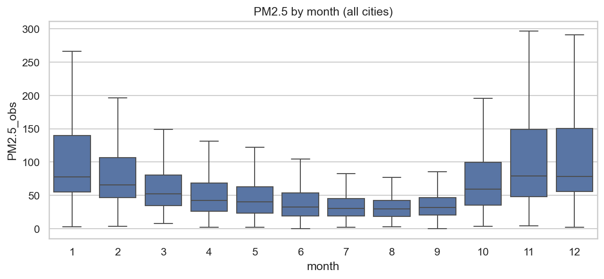
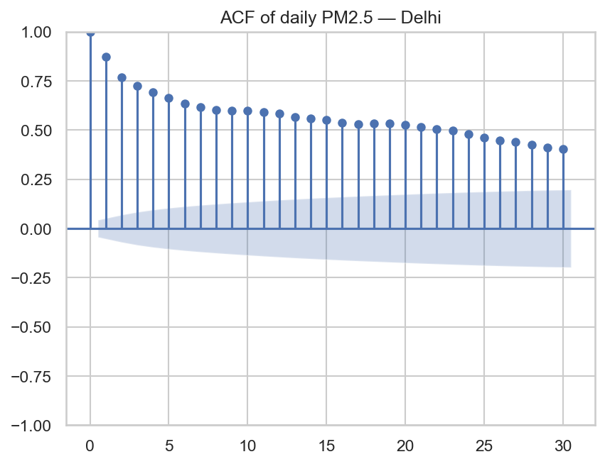
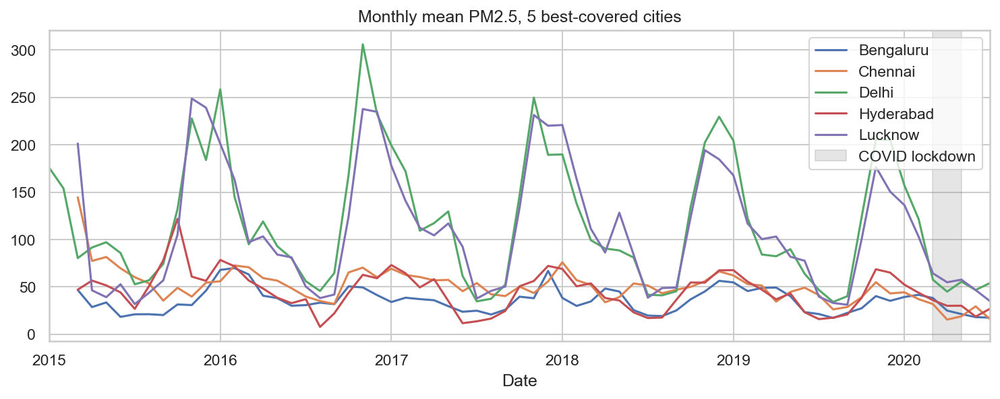
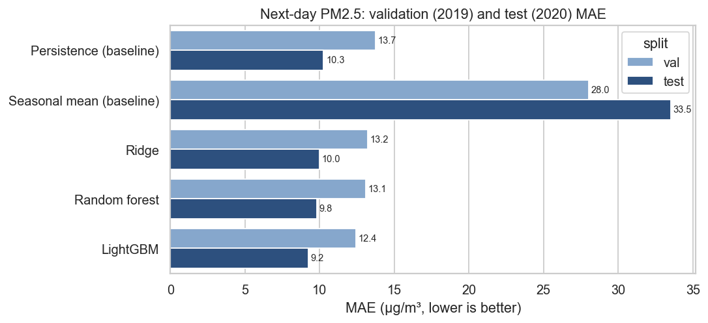
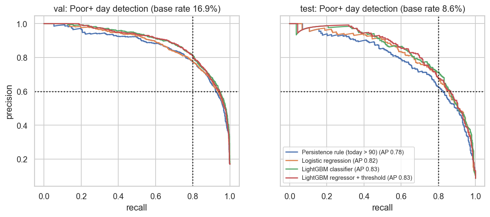
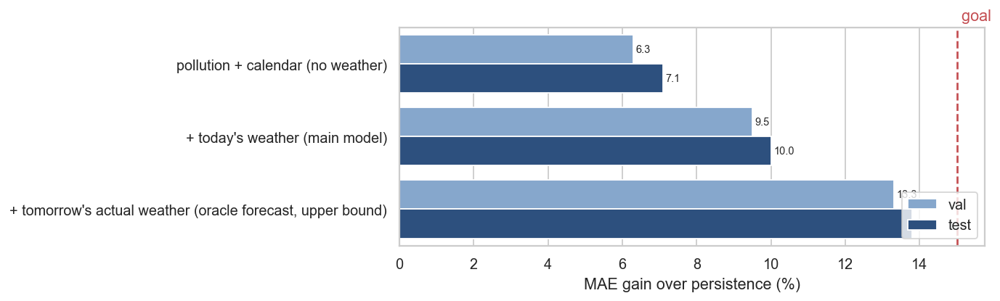
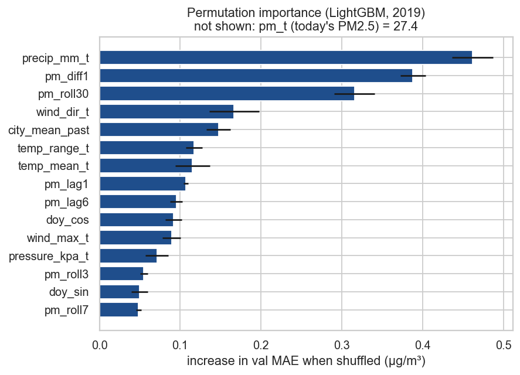
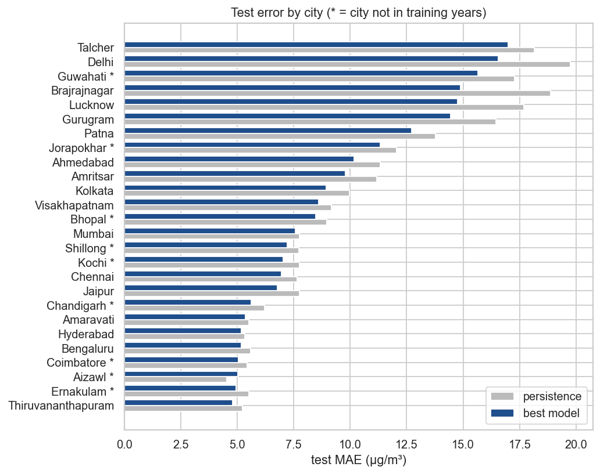
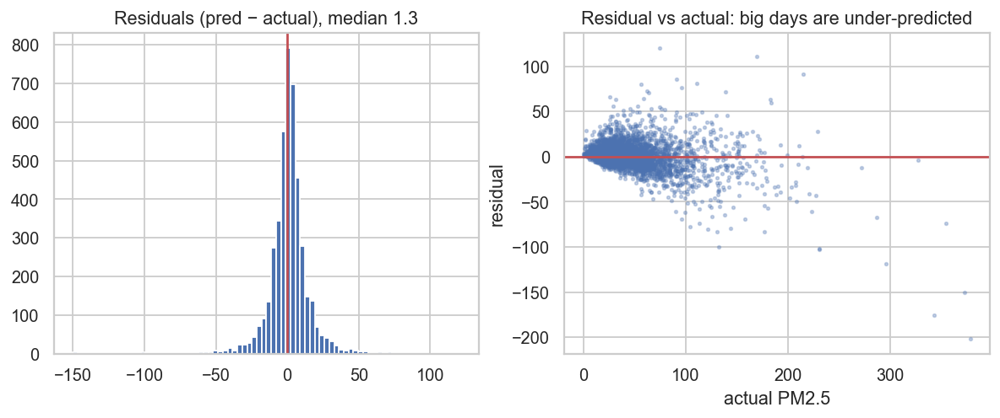
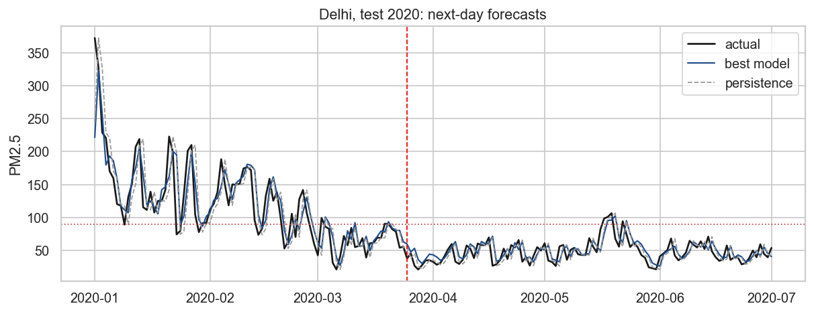

# Forecasting tomorrow's PM2.5 in Indian cities

<div class="subtitle">Data science project (Part A) · CPCB city-day air quality 2015–2020 + NASA POWER weather · all numbers in this report are produced by <code>python -m src.run_all</code> (seed 42)</div>

## 1. Problem and goals

Fine particulate matter (PM2.5) is India's most harmful air pollutant. A one-day-ahead warning lets schools, outdoor workers and people with asthma plan around bad days. The question is:

> **Can we forecast a city's PM2.5 for tomorrow, and flag "Poor or worse" days (24-h PM2.5 > 90 µg/m³, the CPCB AQI breakpoint) one day ahead, better than simply assuming tomorrow will be like today?**

We fixed two measurable goals **before** modelling and keep them unchanged in the evaluation:

| # | Goal | Why this bar |
|---|---|---|
| G1 | Test-year MAE at least **15% lower than persistence** ("tomorrow = today") | Persistence is the forecast anyone can make for free; a model is only useful if it clearly beats it. |
| G2 | Poor+ days: **recall ≥ 0.80 with precision ≥ 0.60** on the test year | Missing a bad day (false negative) costs more than an unneeded warning, but too many false alarms make people ignore them. |

## 2. Data

| Source | What | Size | Why |
|---|---|---|---|
| Kaggle `rohanrao/air-quality-data-in-india`, `city_day.csv` (compiled from the Central Pollution Control Board's public station data) | Daily city averages of 12 pollutants + AQI | 29,531 city-days, 26 cities, 1 Jan 2015 – 1 Jul 2020 | Official, real, India-specific and messy (missing values, sensor faults), with a time order that makes leakage a real risk. |
| NASA POWER daily API (MERRA-2 reanalysis), downloaded per city by `src/weather.py` | Temperature (mean, range), rain, wind speed/direction, humidity, pressure | 52,260 city-days | Weather controls how pollution disperses (rain washes it out, winter inversions trap it). |

Coverage is very uneven (Figure 1 in the notebook): Delhi, Lucknow, Chennai, Hyderabad and Bengaluru have ~2,000 days, while 9 cities only appear in 2019–2020. This matters for the split (Section 4).

## 3. Data preparation and EDA

Each cleaning rule is implemented in `src/clean.py`, justified in its docstring, unit-tested in `tests/test_clean.py`, and counted in `reports/cleaning_report.json`.

| Issue | What we found | Decision and reason |
|---|---|---|
| Types | `Date` as text, `City` as text | Parse dates; city as category. |
| Duplicates | 0 duplicate (City, Date) rows | Rule kept (keep first) so the pipeline stays safe on new data. |
| Gaps in the calendar | Some cities skip days | Reindex each city to a full daily calendar, so `lag 1` really means *yesterday*. |
| Impossible values | 177 values above physical caps (CO 120, Benzene 35, Toluene 22) | Set to NaN: these are sensor/unit errors. |
| Suspicious spikes | e.g. Gurugram 950 µg/m³ on 29 Aug 2017, Guwahati 917 in May 2019, next to days of ~40 | 16 PM2.5 readings >300 and >6× the city's **previous**-30-day median, outside the Oct–Jan smog season, set to NaN. Smog-season extremes (Diwali, stubble burning, Nov 2016 Delhi-NCR smog) are **kept**: they are the days that matter most. |
| Sparse columns | PM10 54% and Xylene 61% missing in the training years | Dropped (threshold 50%, measured on train years only so the test period cannot influence the choice). |
| Missing values | Mostly *structural*: whole stations never measure some pollutants (heatmap) | Forward-fill ≤3 days within a city (past only; interpolation would use tomorrow's value and leak) + a `was_missing` flag; the rest is median-imputed **inside** the model pipeline. The target is **never** imputed. |

<figure><figcaption>Figure 1. PM2.5 by month, all cities. Winter medians (~78) are 2.5× the monsoon ones (~30).</figcaption></figure>

**Key EDA insights and the decisions they led to** (full plots and written insights in `notebooks/01_eda.ipynb`):

1. **Strong seasonality** (Fig. 1): a U-shape with a Nov–Jan peak and a Jul–Sep trough. → Calendar features of the *target* day (month, season, smooth day-of-year) and a Diwali-window flag.
2. **Very strong day-to-day persistence**: Delhi's autocorrelation is 0.87 at lag 1 and still 0.6 after a week (Fig. 2). → Lag 1/2/6 and 3/7/30-day rolling means. Persistence will be a hard baseline, so models predict the **change** from today.
3. **5× differences between cities**, and cities that exist only in val/test. → No city ID; a city's level comes from its own past (30-day rolling mean, expanding past mean).
4. **Distribution shift over time**: the Poor+ share falls from ~30% (2015–17) to 17% (2019) and 9% (2020), and the COVID lockdown (25 Mar 2020) cut PM2.5 sharply (Fig. 3). → Split by time; analyse the lockdown separately.
5. **Pollutants correlate only moderately with PM2.5** (Spearman 0.2–0.45). → Kept as weak same-day features.

<figure><figcaption>Figure 2 (top). Autocorrelation of Delhi's daily PM2.5. Figure 3 (bottom). Monthly means of the 5 best-covered cities; grey band = lockdown.</figcaption></figure>

**Feature engineering** (`src/features.py`, 34 features). One row = (city, day *t*), target = observed PM2.5 on *t*+1. Features use only what is known at the end of day *t*: today's PM2.5 and its lags, rolling means/std, day-to-day change, the city's expanding past mean (a leak-free form of target encoding that also works for new cities), 9 other pollutants with missing flags, today's weather, and calendar features of the target day. Tomorrow's *actual* weather is kept aside and used only as an "oracle forecast" ablation (Section 5.3). `tests/test_features.py` changes every value **after** a cutoff date and checks that no feature row on or before the cutoff changes.

## 4. Method

**Split by time, never shuffled.** Train = targets in 2015–2018 (13,237 rows, 17 cities), validation = 2019 (7,115 rows, 23 cities), test = Jan–Jun 2020 (4,464 rows, 26 cities). A random split would put tomorrow's row in training and today's in test; with autocorrelation 0.87 that would make every model look far better than it is.

**Protocol.** (1) Tune hyperparameters with 5-fold *expanding-window* cross-validation on the training years; folds are cut on dates so a validation fold is always later than its training data. (2) Refit on all training years and score on 2019; choose the model and the classification threshold here. (3) Refit on 2015–2019 and score **once** on 2020. Imputation, scaling and one-hot encoding live inside sklearn `Pipeline`s, so they are re-fitted within every fold.

| Model | Why | Tuning |
|---|---|---|
| Persistence (baseline) | The free forecast to beat | – |
| Seasonal mean (baseline) | City × month average from training | – |
| Ridge regression | Simple, interpretable linear model | α grid (13 values) |
| Random forest | Non-linear, robust to outliers and collinearity | 8 random draws of depth / leaf size / features |
| LightGBM | Gradient boosting: usually best on tabular data, handles interactions (e.g. rain × season) | 25 random draws incl. loss (L2 / L1 / Huber) |

All three ML regressors predict **y − today's PM2.5** and add it back. Learning the correction to persistence is easier than learning the level from scratch, and lets trees predict values outside the range seen in training. For the Poor+ flag we compare the persistence rule (today > 90), logistic regression and a LightGBM classifier (both with class weighting, tuned on CV PR-AUC), plus the LightGBM regressor with a threshold. Each threshold is the highest one that still gives recall ≥ 0.80 on **2019**.

## 5. Results

### 5.1 Regression (G1)

| Model | CV MAE (train yrs) | Val MAE 2019 | Test MAE 2020 | Test RMSE | Test gain vs persistence (95% CI) |
|---|---|---|---|---|---|
| Persistence | 21.5 ± 4.4 | 13.72 | 10.26 | 17.37 | – |
| Seasonal mean | 39.8 ± 11.7 | 28.03 | 33.52 | 42.21 | −227% |
| Ridge | 20.8 ± 4.4 | 13.21 | 9.99 | 15.95 | 2.6% [0.2, 4.8] |
| Random forest | 20.7 ± 4.5 | 13.08 | 9.80 | 15.67 | 4.5% [2.8, 6.2] |
| **LightGBM** | **20.2 ± 4.5** | **12.42** | **9.23** | **14.99** | **10.0% [8.2, 11.7]** |

The confidence intervals come from a paired bootstrap over **days** (all cities on a day are resampled together, because their errors are correlated). The ranking is the same in CV, validation and test, which suggests the choice of LightGBM is not a fluke of one split. The CV MAE is higher than val/test because the early CV folds are 2015–2017, the most polluted years.

**G1 is not met:** LightGBM beats persistence by 10.0% (CI 8.2–11.7%), clearly and significantly, but short of 15%. The seasonal-mean baseline is 3× worse than persistence: knowing *the season* is far less useful than knowing *yesterday*.

<figure><figcaption>Figure 4. MAE of all models on validation and test.</figcaption></figure>

### 5.2 Poor+ classification (G2)

| Model | Val recall / precision | Test recall | Test precision | Test F1 | Test PR-AUC |
|---|---|---|---|---|---|
| Persistence rule (today > 90) | 0.79 / 0.79 | 0.735 | 0.713 | 0.724 | 0.783 |
| Logistic regression | 0.80 / 0.77 | 0.790 | 0.691 | 0.737 | 0.815 |
| LightGBM classifier | 0.80 / 0.81 | 0.771 | 0.733 | 0.752 | 0.829 |
| LightGBM regressor + threshold (chosen on val F1) | 0.80 / 0.81 | 0.748 | 0.742 | 0.745 | 0.831 |

**G2 is narrowly missed:** precision (0.74) is well above 0.60, but recall falls from 0.80 on 2019 to 0.75 on 2020. The threshold was fixed on 2019 and 2020 has half the Poor+ rate (8.6% vs 16.9%), so the same threshold catches fewer borderline days. As a diagnostic only (not used for any choice), the test PR curve shows the LightGBM classifier could reach recall 0.80 at precision 0.72, so the model *can* meet G2; the miss comes from calibrating the threshold on a dirtier year. All ML classifiers beat the persistence rule in PR-AUC (0.83 vs 0.78).

<figure><figcaption>Figure 5. Precision–recall curves; dotted lines mark the G2 targets.</figcaption></figure>

### 5.3 What drives the improvement? Feature ablation

<figure><figcaption>Figure 6. LightGBM gain over persistence with different feature groups (same tuned hyperparameters).</figcaption></figure>

Pollution history and calendar alone give 7%. Adding today's weather raises this to 10%. Giving the model tomorrow's **actual** weather (what a perfect weather forecast would provide) reaches 13.8% on test, still just under 15%. So **G1 is probably out of reach with day-level data and these features, even with perfect weather**; the remaining error is day-to-day variation (local emissions, fires, transport of smoke) that none of our inputs observe. Permutation importance agrees: after today's PM2.5, the most useful inputs are today's **rainfall**, the latest day-to-day change, the 30-day level and wind direction (Fig. 7).

<figure><figcaption>Figure 7. Permutation importance on 2019 (increase in MAE when a feature is shuffled).</figcaption></figure>

## 6. Error analysis

**Where does the model fail?**

* **By season and city.** Errors follow pollution levels: winter test MAE 13.6 vs 6.2 in the monsoon. The worst cities are Talcher, Delhi, Guwahati, Brajrajnagar and Lucknow (MAE about 15–17), the most polluted ones (Fig. 8). The model beats persistence in 25 of 26 cities; the exception is Aizawl (5.0 vs 4.5), one of the cleanest cities, with only 110 test days and no training history.
* **Cities never seen in training** (9 cities that start in 2019–20) have *lower* test MAE (7.9) than seen cities (9.9), because most of them are clean. No city ID is used, so the model transfers to them without retraining.
* **Big days are under-predicted.** The median residual is +1.3 (unbiased on typical days), but on Poor+ days the mean residual is **−10.3 µg/m³** (Fig. 9). The model predicts the *change* conservatively: sudden jumps cannot be anticipated from yesterday's data.
* **Turning points.** Of the 20 worst test predictions, 14 are in January (peak season) and are sudden jumps or drops of 80–200 µg/m³ in one day, e.g. Guwahati 15 Jan 2020: today 187 → tomorrow 378, predicted 176. Talcher (a coal-mining town) appears 6 times. These are likely local events (fires, mining, festival burning) with no signature in the inputs.
* **Diwali.** In the ±2-day Diwali window of 2019 the MAE is 25.4 vs 30.2 for persistence, so the Diwali flag helps, but errors remain twice the yearly average.
* **COVID lockdown (distribution shift inside the test year).** Before 25 March 2020 the model's MAE is 12.4 (persistence 14.0); afterwards 6.6 (persistence 7.2). The model kept its ~10% edge through the shift, because it forecasts changes relative to the current level rather than absolute levels learned from dirtier years. Fig. 10 shows Delhi.

<figure><figcaption>Figure 8. Test MAE per city (* = city absent from the training years).</figcaption></figure>

<figure><figcaption>Figure 9. Test residuals: centred near zero, but large actual values are under-predicted.</figcaption></figure>

<figure><figcaption>Figure 10. Delhi, test 2020: the model (blue) follows the actual series (black) closely but, like persistence, reacts a day late to sudden jumps. Red line = lockdown.</figcaption></figure>

## 7. Limitations, bias and next steps

**Limitations.**

- *Daily city averages hide a lot:* the data averages several stations per city into one daily number, so local plumes and within-day peaks are invisible.
- *Weather resolution:* NASA POWER is a ~50 km reanalysis grid, so a city's local weather is approximated. In real use tomorrow's weather would come from an imperfect forecast, so the oracle ablation (13.8%) is an upper bound.
- *Short, shifting test period:* the test covers only January–June 2020 (no post-monsoon season) and includes the lockdown, so 2020 is not a typical year. The classification threshold, tuned on 2019, did not transfer perfectly.
- *Missing data is not random:* whole pollutants are missing for some cities, and Mumbai is ~60% missing. Imputation plus flags handles this mechanically, but those cities' features are less informative.

**Bias.**

- Training data comes mostly from large North-Indian and metro cities; 9 cities (several in the North-East and Kerala) contribute **no** training rows. The model works well on them in 2020 mostly because they are clean, and it is untested on a *polluted* unseen city.
- Pooling all cities into one MAE weights cities by their number of days, so well-monitored metros dominate the headline number. Small towns with severe pollution (Talcher, Brajrajnagar) have the largest errors, and their residents would get the least reliable warnings.
- The Poor+ threshold applies one national cut-off; health risk also depends on exposure and vulnerability, which the data does not capture.

**Next steps.**

1. Use real weather *forecasts* (e.g. GFS/IMD archives) instead of reanalysis, and add boundary-layer height, the variable most directly linked to trapped pollution.
2. Add fire counts (NASA FIRMS) and upwind cities' PM2.5 to anticipate smoke transport, aimed at the sudden jumps that dominate the worst errors.
3. Recalibrate the Poor+ threshold on a rolling window (e.g. last 365 days) so it adapts to cleaner years.
4. Predict intervals (quantile LightGBM), not just a point, so a warning can say how sure it is.
5. Report per-city error targets so small, polluted towns are not hidden by the national average.

## 8. Conclusion

With careful, leak-free features and a time-based split, a LightGBM model forecasts tomorrow's PM2.5 **10% better than persistence on the unseen 2020 test year (95% CI 8–12%)**, consistently across CV, validation and test, in 25 of 26 cities and through the COVID lockdown shift. It detects Poor+ days with precision 0.74 and recall 0.75. Neither pre-set goal was fully met: the ablation shows that even perfect knowledge of tomorrow's weather would only reach ~14%, which points to unobserved local emissions as the limiting factor rather than the choice of model. The most valuable next step is therefore better *inputs* (weather forecasts, fire and upwind data), not a more complex model.

## Reproducibility

```
pip install -r requirements.txt        # pinned versions, Python 3.12
python -m src.run_all                  # whole pipeline, ~11 min
python -m pytest -q                    # 11 tests incl. no-leakage
python -m src.build_report             # rebuilds this PDF
```
Seed 42 everywhere (`src/config.py`). Tables behind every number: `reports/tables/` (`regression_results.csv`, `classification_results.csv`, `ablation_features.csv`, `summary.json`, `worst20_test.csv`, `error_by_city_test.csv`, `cv_results.csv`, `best_params.json`).
