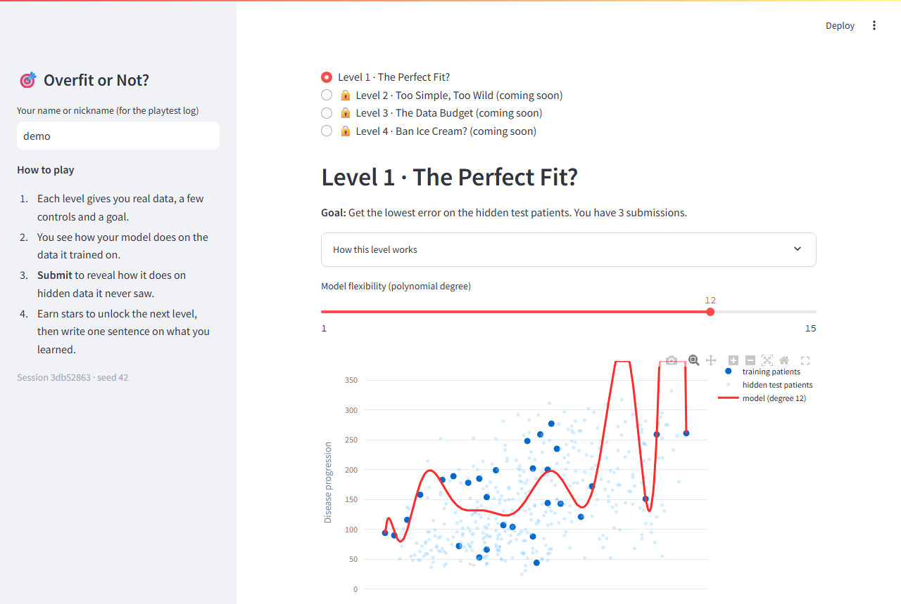

# Overfit or Not? — learn data science by playing

You're a junior data scientist. Your models are judged on data they have **never seen**.
While you play you only see how well a model fits its *training* data; pressing **Submit** reveals the hidden truth.
Nobody tells you the concept: you find it in the gap between the two numbers.



*Screenshot from an earlier build of Level 1.*

## Run it
```bash
pip install -r requirements.txt     # Python 3.12
streamlit run app/main.py           # opens http://localhost:8501
python -m pytest -q                 # 8 tests
```
The tests check three things: every level loads; each concept comes out of the computation (test error rises at high degree; bias falls and variance rises with depth); and a headless play-through of both levels using Streamlit's `AppTest`.

The game is self-contained: Level 2's data (`data/delhi_pm25.csv`) is committed. To rebuild it from Part A's raw data, run `python data/make_data.py`.

If `streamlit` isn't on your PATH, use `python -m streamlit run app/main.py`. If port 8501 is busy, add `--server.port 8502`.

## How to play
1. Type a nickname in the sidebar (it only labels the playtest log).
2. Read the level goal. Move the slider and watch your model and its **training error** change.
3. Press **Submit** to reveal the **hidden test error**. You have **3 submissions per level**, so think before you submit.
4. Read the hint. It reacts to what you actually did (e.g. a big train/test gap triggers the overfitting hint).
5. Earn at least ★ to unlock the next level. When the level ends you see the full picture (error curves for every setting) and write one sentence on what you learned.

### Stars
Your test error is compared with the best error achievable on that level, which the game computes live:
★★★ within 3–5% of the best, ★★ within 10–15%, ★ within 25–30%. No stars = try again.

## Learning objectives
| Level | Concept | After playing you can… | What you control | What gets revealed |
|---|---|---|---|---|
| 1 · The Perfect Fit? | **Overfitting** | explain why a model that fits its training data almost perfectly can predict new data *worse* than a simpler model | polynomial degree 1–15 (starts at a tempting degree 10) | test MSE on held-out patients; at the end, train vs test error for every degree |
| 2 · Too Simple, Too Wild | **Bias–variance trade-off** | find the complexity sweet spot and explain that test error = bias² + variance + noise, with bias falling and variance rising as complexity grows | decision-tree depth 1–12; *Draw another sample*; *Show all 20 analysts* | average test error over 20 analysts, split into bias², variance and noise; at the end, all four curves vs depth |

## Real data, live computation
| Level | Data | Computation |
|---|---|---|
| 1 | scikit-learn's diabetes dataset (442 real patients): BMI → disease progression after one year. 30 random patients are the training set, the rest are hidden. | `PolynomialFeatures(degree)` + linear regression, fitted every time the slider moves. |
| 2 | Daily PM2.5 in Delhi 2015–2019 from CPCB (the same Kaggle dataset as Part A), 1,824 days, `data/delhi_pm25.csv` (rebuilt by `data/make_data.py`). | 20 analysts each draw 100 random days and fit a `DecisionTreeRegressor(max_depth)`. Bias², variance and noise are computed on 400 held-out days against a smoothed "true" seasonal curve. |

Nothing is hard-coded: the best score, stars and hints are all computed from the fits (seed 42, shown in the sidebar). See [levels/DESIGN.md](levels/DESIGN.md) for the design rationale.

## Code layout
| Path | Purpose |
|---|---|
| `app/main.py` | Streamlit shell: sidebar, level unlocking, session state; levels are cached across players |
| `data/delhi_pm25.csv`, `data/make_data.py` | Level 2 data and the script that builds it |
| `app/logger.py` | Writes every submit, resample and reflection to `playtest/logs/<session>.csv` |
| `levels/base.py` | `Level` base class and state (attempts, submissions, reflection) |
| `levels/level1_overfitting.py`, `levels/level2_bias_variance.py` | One module per level: pure computation methods (unit-tested) plus a `render()` UI method |
| `tests/test_levels.py` | Concept tests, e.g. "test error rises at high degree", "bias falls and variance rises with depth", "hints react to the choice" |
| `tests/test_app.py` | Headless UI test: plays through both levels with Streamlit's `AppTest` and deletes its own log afterwards |
| `playtest/` | Protocol, pre/post quizzes, feedback form, logs, `analyze.py`, `REPORT.md` |

## Evidence of learning
| Step | File |
|---|---|
| 1. How to run a session (pre-quiz → play → post-quiz → feedback) | [playtest/PROTOCOL.md](playtest/PROTOCOL.md) |
| 2. Quizzes and form | [quiz_pre.md](playtest/quiz_pre.md), [quiz_post.md](playtest/quiz_post.md), [answer_key.md](playtest/answer_key.md), [feedback_form.md](playtest/feedback_form.md) |
| 3. Raw evidence | `playtest/logs/<session>.csv` (written automatically by the game), `playtest/quiz_results.csv` (filled in by hand) |
| 4. Summary | `python playtest/analyze.py` → [playtest/summary.md](playtest/summary.md) |
| 5. Final write-up | [playtest/REPORT.md](playtest/REPORT.md): pre/post scores, gameplay, reflections, feedback, the change made |

**Status:** 1 peer session has been logged so far (`playtest/logs/4d12fffa.csv`: the player went degree 9 → 12 → 3 and earned ★★★ on the third try, which is the intended discovery path). The quiz and feedback results from at least 5 peers still need to be collected and written into `REPORT.md`.

One change has already come from testing: Level 1's slider used to start at degree 1, which already earned ★★★, so a player could pass without discovering anything. It now starts at a tempting degree 10, which earns 0 stars.
